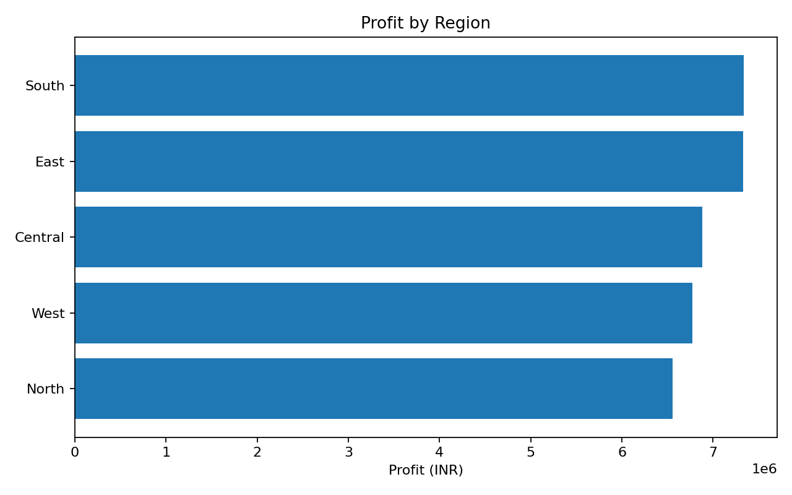
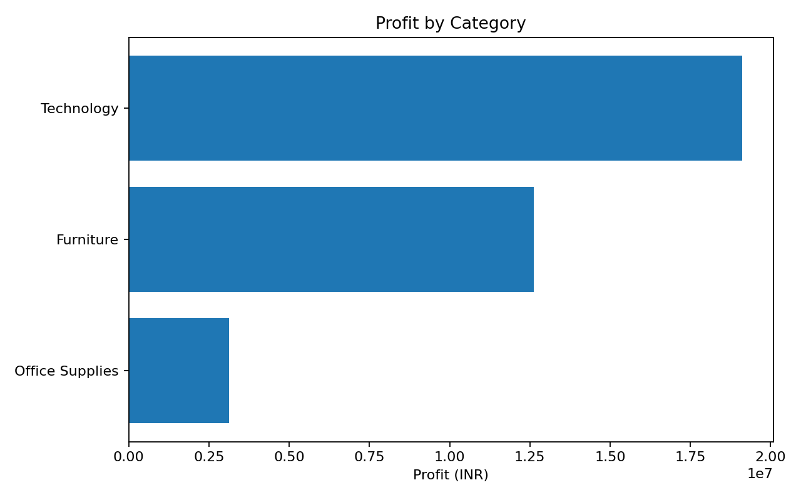
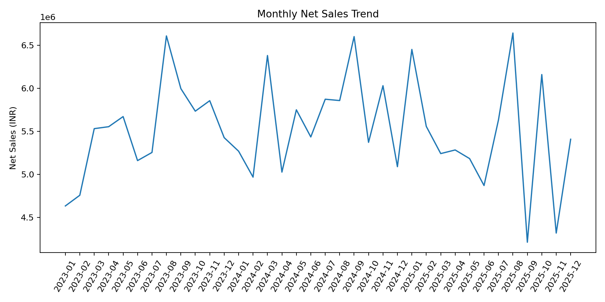

# Sales Revenue & Profitability Optimization

This project examines retail sales data to understand what drives revenue and profitability across different regions and product categories. Using SQL, Python, and Excel, I analyzed 7,500 transactions, explored sales patterns, and identified areas where the business was losing money. The goal was to turn the data into useful insights that could support better pricing, discounting, and business decisions.

## Project Overview

I worked with retail transaction data from 2023 through 2025, starting with cleaning the dataset and removing duplicate records. From there, I used SQL to examine sales performance, product profitability, regional trends, and the impact of discounts. I also used Python to explore the data and created an Excel dashboard to summarize key results. One finding was that 402 transactions were unprofitable, highlighting opportunities to review discounting and improve profit margins.

## Dataset Summary

* **Raw records:** 7,535
* **Cleaned records:** 7,500
* **Exact duplicates removed:** 35
* **Unique customers:** 800
* **Regions:** North, South, East, West, Central
* **Categories:** Technology, Furniture, Office Supplies

## Tools Used

* **Excel** — data cleaning, KPI summary and dashboard
* **SQL** — business queries and profitability analysis
* **Python / Pandas** — exploratory data analysis
* **Matplotlib** — visualizations
* **GitHub** — project documentation and portfolio hosting

## Key KPIs

|KPI|Result|
|-|-:|
|Total Orders|7,500|
|Unique Customers|800|
|Net Sales|₹198,854,948.37|
|Total Profit|₹34,867,417.88|
|Profit Margin|17.53%|
|Loss-Making Orders|402|

## Key Business Insights

* **South** generated the highest total profit.
* **Technology** was the most profitable category.
* **402 orders** were loss-making, showing the importance of discount and cost control.
* Regional and category analysis helps identify where sales growth is translating into healthy profitability.
* Profit margin should be monitored alongside revenue to avoid unprofitable growth.

## Visualizations

### Profit by Region

### Profit by Category

### Monthly Net Sales Trend

## Repository Files

|File|Purpose|
|-|-|
|`retail_sales_raw.csv`|Original raw dataset|
|`retail_sales_cleaned.csv`|Cleaned dataset used for analysis|
|`Retail_Business_Analysis.xlsx`|Excel analysis, KPI summary and dashboard|
|`retail_analysis.sql`|SQL business-analysis queries|
|`Retail_sales_analysis.sql`|Additional SQL queries for retail sales and profitability analysis|
|`retail_analysis.py`|Python/Pandas analysis script|
|`business_insights.md`|Detailed findings and recommendations|
|`profit_by_region.png`|Regional profitability visualization|
|`profit_by_category.png`|Category profitability visualization|
|`monthly_net_sales_trend.png`|Monthly sales trend visualization|

## Data Cleaning Performed

* Removed exact duplicate records.
* Recovered missing customer names using Customer ID mapping where possible.
* Filled unsupported missing state values as `Unknown` instead of guessing.
* Added **Net Sales = Sales × (1 - Discount)**.
* Added **Profit Margin = Profit / Net Sales**.
* Standardized date and numeric fields for analysis.

## SQL Analysis

The SQL analysis covers overall KPIs, regional performance, category and sub-category profitability, top products, monthly/yearly trends, discount impact, loss-making orders and top customers.

## Resume-Ready Project Description

**Retail Business Performance \& Profitability Analysis** — Analyzed **7,500 retail order records** using Python, SQL and Excel. Cleaned and transformed raw sales data, evaluated revenue and profitability trends, identified **402 loss-making transactions**, and developed a structured Excel dashboard to communicate regional, category and KPI performance.

## Author

**Maaz Foshanji**  
Data Analyst | Python | SQL | Excel | Power BI | Tableau

